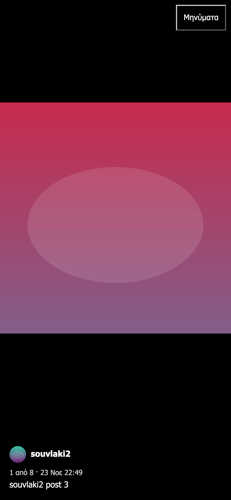
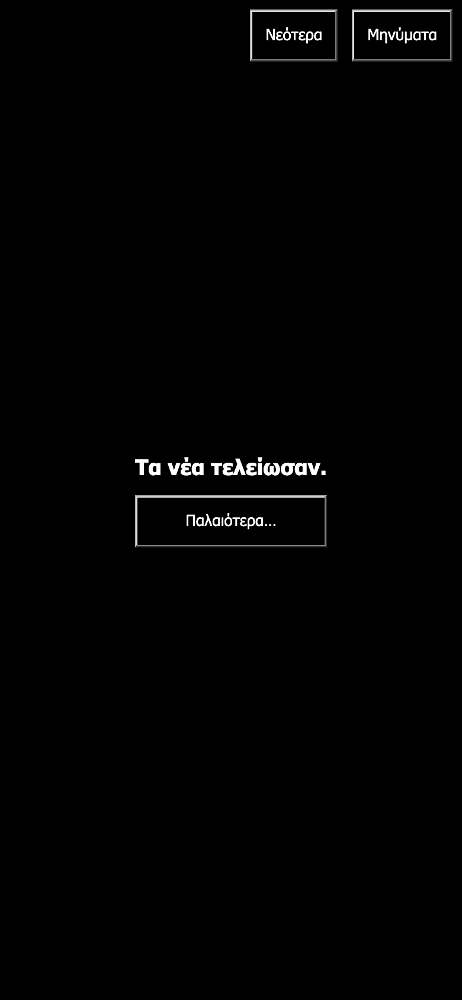
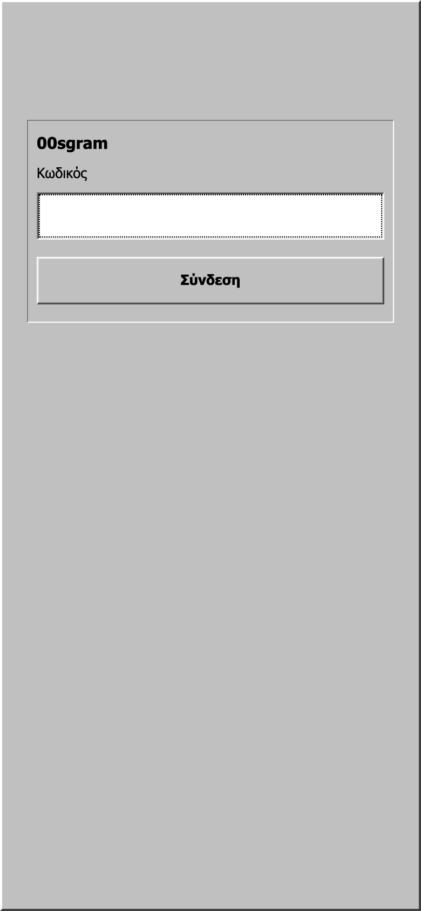

# 00sgram

A distraction-free, self-hosted Instagram client. One card at a time — today's
posts, the stories you have not watched, and an end. No algorithm, no infinite
scroll, no likes to chase while you were only looking for one thing.

It runs on your own machine, on your own account, through a real Chromium that
is logged in once. There is no cookie to copy and no password login (Instagram
refuses those for new sessions anyway).



## What works

| | |
|---|---|
| Feed | Posts from the last 24 h, newest first, one per screen. Swipe or keys. |
| Stories | Rings you have not watched; a card per account, segments on the same swipe axis. A story is marked seen only after you actually sit on it. |
| «Παλαιότερα» | Older posts, by day, from the end of the deck. Only cards whose media are actually cached. |
| Media | Images and videos proxied through the app and cached on disk, with a budget (default 1 GB, oldest evicted first). |
| Sync | Every 30 min, plus a weekly history backfill. |
| Messages | **Experimental.** Instagram DMs mirrored to a Telegram group and back. See below. |

The interface is in Greek; the copy lives in one table
(`app/static/str.js`).

## Requirements

- Docker with the compose plugin (2 GB RAM free is plenty).
- An Instagram account you can log into in a browser.
- A machine that stays on — a Pi, a NAS, an old laptop.
- ~1 GB of disk for the media cache, plus a few MB for the database.

## Quick start

**1. Get the code and a config.**

```sh
git clone <this repo> 00sgram && cd 00sgram
cp .env.example .env
```

**2. Fill three secrets in `.env`.**

```sh
# a long random string
python3 -c "import secrets; print(secrets.token_urlsafe(32))"   # APP_SECRET
python3 -c "import secrets; print(secrets.token_urlsafe(24))"   # API_TOKEN
```

Then set `APP_PASSWORD` to whatever you want to type to get in, and tell it to
use the browser provider:

```sh
PROVIDER=browser
APP_SECRET=<the first value>
API_TOKEN=<the second value>
APP_PASSWORD=<your password>
DATA_HOME=./data
```

`DATA_HOME` is where the database, the media cache and the browser profile live.
On a Mac or a dev machine `./data` beside the repo is the easy answer; on a Pi
the compose file defaults to `/srv/00sgram/data`.

**3. Log in to Instagram once.**

The browser profile *is* the credential, so this happens with the app stopped —
two Chromiums on one profile deadlock.

```sh
docker compose build
docker compose run --rm -p 5900:5900 web python -m app.browser_login
```

A Chromium window opens on a virtual display. Point a VNC client at
`localhost:5900` (macOS: Finder → Go → *Connect to Server* → `vnc://localhost:5900`;
on Linux, `vncviewer localhost:5900`), log in, and close the window when it tells
you the login is saved. Nothing else will ever ask for credentials.

**4. Start it.**

```sh
docker compose up -d
```

Open <http://localhost:8091> and log in with `APP_PASSWORD`.

**5. Wait for the first sync — or ask for it.**

The scheduler runs 15 seconds after boot and the first run is a history
backfill (`BACKFILL_DAYS`, 7 by default). Posts appear by themselves. If you are
impatient, ask for a cycle now:

```sh
curl -X POST -H "x-api-token: $(grep '^API_TOKEN=' .env | cut -d= -f2-)" \
     -H "x-device: cli" http://localhost:8091/api/sync/run
```

When the 24-hour window is empty and everything has been read, the deck says so:



## On a phone

The app is a plain web page; add it to your home screen and it behaves like an
app. On the same LAN use the machine's address — `http://192.168.1.50:8091` —
not `localhost`.

The first screen you see when the session is cold:



## Configuration

Everything lives in `.env`; `docker compose up -d` after a change re-reads it.
The ones that matter:

| Variable | Default | What it does |
|---|---|---|
| `PROVIDER` | `instagrapi` | `browser` for a real Chromium (recommended), `mock` for a demo with fake data, `instagrapi` for the old cookie path. |
| `APP_PASSWORD` | — | The password for the web app. |
| `APP_SECRET` | — | Signs the session cookie. At least 32 characters. Changing it logs everyone out. |
| `API_TOKEN` | — | Bearer token for the API and the MCP server. Treat it as root. |
| `DATA_HOME` | `/srv/00sgram/data` | Host directory mounted at `/data`. |
| `SYNC_INTERVAL` | `1800` | Seconds between feed syncs (300–86400). |
| `BACKFILL_DAYS` | `7` | How far back the first history walk goes. |
| `MEDIA_CACHE` | `1` | `0` proxies without storing anything. |
| `MEDIA_BUDGET_MB` | `800` | Disk ceiling for cached media; the oldest files go first. |
| `MEDIA_RETENTION_DAYS` | `30` | Nothing older is kept, whatever the budget says. |
| `VIEW_THRESHOLD_MS` | `1000` | How long a story segment must stay on screen to count as watched. |

## Messages (experimental)

The Telegram half of this project is usable but not finished: it mirrors
Instagram conversations into a Telegram forum group (one topic per person) and
sends your replies back.

It needs a bot (`TELEGRAM_TOKEN` from @BotFather) and the id of a forum group the
bot is in (`TELEGRAM_RELAY_CHAT`). The app only ever speaks in that one chat —
anything else that messages the bot is dropped before it is stored.

What it does **not** do yet: attachment forwarding, read state both ways, more
than one platform. It will be split into its own service; treat it as a preview.

Two things worth knowing before you turn it on: opening a conversation registers
a read receipt on Instagram, and answering from the portal sends as the bot, not
as you.

## Development

```sh
python3 -m venv ~/venvs/00sgram
~/venvs/00sgram/bin/pip install -r requirements-dev.txt
~/venvs/00sgram/bin/python -m pytest -q        # the whole suite, offline
node tests/browse_check.mjs                    # the deck, against a fake DOM
```

Python changes need a rebuild (`docker compose build web && docker compose up -d
web`); front-end-only changes deploy with `sh scripts/deploy-static.sh`.

A demo instance with fake data, no Instagram account required:

```sh
PROVIDER=mock DATA_DIR=./demo ~/venvs/00sgram/bin/python -m app.dev_seed
PROVIDER=mock DATA_DIR=./demo ~/venvs/00sgram/bin/python -m uvicorn app.asgi:app --port 8099
```

The screenshots above were taken from exactly that.

## Risks, said plainly

- Automating Instagram is against its terms. This reads, mostly, but the account
  can be limited or challenged anyway. The app has a pause that freezes sync when
  that happens; nothing else overrides it.
- Anything you enable that writes to Instagram (likes, story reactions) is a
  deliberate tap, never automatic — and it raises that risk.
- The app is a LAN tool: no HTTPS, no rate limiting, one password. Do not expose
  it to the internet as it is.

Design notes and the long history of decisions are in `docs/`; the phase log this
file used to hold is in `docs/readme-history.md`.
